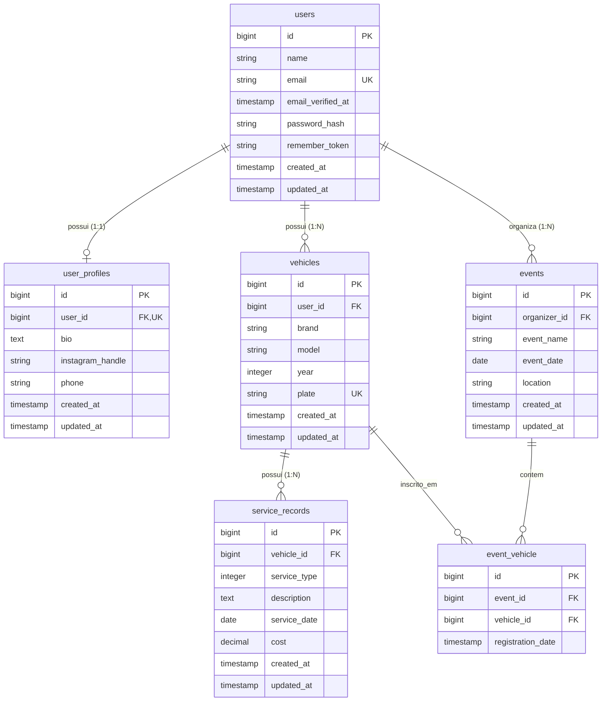

# Vehicle Events API

[](https://github.com/huguerra1/vehicle_events/actions/workflows/ci.yml)
[](LICENSE)

API REST desenvolvida em **Laravel 13** (PHP 8.3) com autenticação OAuth2 via **Laravel Passport** para cadastro e gerenciamento de usuários, perfis, veículos, histórico de manutenções e eventos automotivos. Projeto desenvolvido como teste técnico para vaga de estagiário desenvolvedor.

## Sobre o projeto

Cada usuário autenticado pode cadastrar seu próprio perfil, seus veículos e o histórico de manutenções de cada veículo, além de organizar eventos automotivos e inscrever veículos neles. O acesso aos dados sensíveis e pessoais é isolado por usuário: cada conta só visualiza, edita ou remove os próprios registros.

## Tecnologias

- **PHP 8.3**
- **Laravel 13**
- **Eloquent ORM**
- **Laravel Passport 13** (autenticação OAuth2 via Personal Access Tokens)
- **PostgreSQL 16** (banco principal via Docker; **SQLite** em memória na suíte de testes)
- **PHPUnit 12** + **GitHub Actions** (integração contínua)

## Como rodar

### (a) Com Docker (em um comando)

Basta ter o Docker e o Docker Compose instalados e executar na raiz do projeto:

```bash
docker compose up --build
```

A API ficará disponível em `http://localhost:8000` (rotas sob `http://localhost:8000/api/...`).

O script `docker/entrypoint.sh` executa automaticamente na inicialização do container `app`:
1. Copia `.env.example` para `.env` caso o arquivo ainda não exista.
2. Gera a `APP_KEY` caso esteja vazia.
3. Aguarda o serviço `db` (`postgres:16`) aceitar conexões.
4. Roda as migrations (`php artisan migrate --force`).
5. Gera o par de chaves RSA do Passport (`php artisan passport:keys`) se não existirem em `storage/`.
6. Cria o *Personal Access Client* (`php artisan passport:client --personal --no-interaction`) caso ainda não exista na tabela `oauth_clients`.
7. Executa os seeders se o banco estiver vazio.
8. Inicia o servidor em `0.0.0.0:8000`.

> **Variáveis de banco no Docker Compose (valores exclusivos para desenvolvimento local):**
> - `DB_CONNECTION=pgsql`
> - `DB_HOST=db`
> - `DB_PORT=5432`
> - `DB_DATABASE=vehicle_events`
> - `DB_USERNAME=vehicle_events`
> - `DB_PASSWORD=secret`

### (b) Localmente com PHP e Composer

Pré-requisitos: PHP 8.3+ (com extensões `pdo_pgsql`, `pgsql`, `mbstring`, `bcmath`, `intl`, `zip`), Composer 2 e PostgreSQL (ou SQLite).

```bash
composer install
cp .env.example .env
php artisan key:generate
```

Configure as variáveis de conexão `DB_*` no arquivo `.env` (ou mantenha `DB_CONNECTION=sqlite` para desenvolvimento rápido local, observando que a busca textual com `ILIKE` em veículos e eventos é específica do PostgreSQL) e execute:

```bash
php artisan migrate
php artisan passport:keys
php artisan passport:client --personal --no-interaction
php artisan db:seed
php artisan serve
```

## Autenticação

A autenticação é feita via **Personal Access Tokens** do Laravel Passport. As rotas `/api/register` e `/api/login` retornam o objeto `user` e a chave `token`, que deve ser enviada no cabeçalho `Authorization: Bearer {token}` nas rotas protegidas pelo middleware `auth:api`.

### 1. Registrar um novo usuário (`POST /api/register`)

Campos obrigatórios: `name` (string, máx. 255), `email` (e-mail único) e `password` (string, mín. 8 caracteres). Retorna status **`201 Created`**.

```bash
curl -i -X POST http://localhost:8000/api/register \
  -H "Accept: application/json" \
  -H "Content-Type: application/json" \
  -d '{
    "name": "João Silva",
    "email": "joao@example.com",
    "password": "senha-segura"
  }'
```

Exemplo de resposta (`201 Created`):

```json
{
  "user": {
    "id": 1,
    "name": "João Silva",
    "email": "joao@example.com",
    "created_at": "2026-11-10T00:00:00.000000Z",
    "updated_at": "2026-11-10T00:00:00.000000Z"
  },
  "token": "eyJ0eXAiOiJKV1QiLCJhbGciOiJSUzI1NiJ9..."
}
```

### 2. Fazer login (`POST /api/login`)

Campos obrigatórios: `email` e `password`. Retorna status **`200 OK`** em caso de sucesso ou **`401 Unauthorized`** (`{"message": "Credenciais inválidas."}`) se o e-mail ou a senha estiverem incorretos.

```bash
curl -i -X POST http://localhost:8000/api/login \
  -H "Accept: application/json" \
  -H "Content-Type: application/json" \
  -d '{
    "email": "joao@example.com",
    "password": "senha-segura"
  }'
```

### 3. Consumir rotas autenticadas com o token Bearer

Envie os cabeçalhos `Authorization: Bearer {token}` e `Accept: application/json`:

```bash
# Exemplo: cadastrar um veículo (retorna 201 Created)
curl -i -X POST http://localhost:8000/api/vehicles \
  -H "Accept: application/json" \
  -H "Content-Type: application/json" \
  -H "Authorization: Bearer SEU_TOKEN_AQUI" \
  -d '{
    "brand": "Toyota",
    "model": "Corolla",
    "year": 2022,
    "plate": "ABC1D23"
  }'

# Exemplo: consultar o usuário autenticado (retorna 200 OK)
curl -i -X GET http://localhost:8000/api/user \
  -H "Accept: application/json" \
  -H "Authorization: Bearer SEU_TOKEN_AQUI"
```

## Rotas da API (`routes/api.php`)

Para testar rapidamente todas as rotas no **Postman** ou **Insomnia**, importe o arquivo [`docs/vehicle_events.postman_collection.json`](docs/vehicle_events.postman_collection.json) (*Import* → selecione o JSON). A ordem sugerida é executar primeiro **Autenticação → Registrar usuário** (ou **Login**): o script de pós-resposta salva automaticamente o `token` na variável da coleção, autenticando todas as demais requisições; da mesma forma, os endpoints de criação salvam automaticamente `vehicleId`, `serviceRecordId` e `eventId`.

Todas as rotas estão sob o prefixo `/api`.

| Método | Caminho | Autenticação | Descrição |
|---|---|---|---|
| `POST` | `/api/register` | Pública | Registra um novo usuário (`name`, `email`, `password`) e retorna `{ user, token }` (`201 Created`). |
| `POST` | `/api/login` | Pública | Autentica o usuário (`email`, `password`) e retorna `{ user, token }` (`200 OK` ou `401 Unauthorized`). |
| `GET` | `/api/service-types` | Pública | Lista o catálogo fixo de tipos de serviço (`id` e `name` do enum `ServiceType`). |
| `GET` | `/api/user` | `Bearer (auth:api)` | Retorna os dados do usuário autenticado pelo token. |
| `GET` | `/api/users` | `Bearer (auth:api)` | Lista os usuários cadastrados (sem expor `password_hash` ou `remember_token`). |
| `GET` | `/api/users/{id}` | `Bearer (auth:api)` | Exibe os dados de um usuário pelo ID (`404` se não encontrado). |
| `PUT` | `/api/users/{id}` | `Bearer (auth:api)` | Atualiza `name` e/ou `email` do próprio usuário autenticado (`404` se tentar editar outro usuário). |
| `DELETE` | `/api/users/{id}` | `Bearer (auth:api)` | Exclui o próprio usuário autenticado (`204 No Content`, ou `404` se for outro usuário). |
| `GET` | `/api/profile` | `Bearer (auth:api)` | Exibe o perfil (`bio`, `instagram_handle`, `phone`) do usuário autenticado (`404` se não existir). |
| `POST` | `/api/profile` | `Bearer (auth:api)` | Cria o perfil do usuário autenticado (`201 Created`, ou `409 Conflict` se já existir). |
| `PUT` | `/api/profile` | `Bearer (auth:api)` | Atualiza o perfil do usuário autenticado (`404` se ainda não tiver sido criado). |
| `GET` | `/api/vehicles` | `Bearer (auth:api)` | Lista paginada (`page`, `per_page`, `search`) apenas dos veículos do usuário autenticado. |
| `POST` | `/api/vehicles` | `Bearer (auth:api)` | Cadastra um veículo (`brand`, `model`, `year`, `plate`) para o usuário autenticado (`201 Created`). |
| `GET` | `/api/vehicles/{id}` | `Bearer (auth:api)` | Exibe um veículo específico se pertencer ao usuário autenticado (`404` caso contrário). |
| `PUT` | `/api/vehicles/{id}` | `Bearer (auth:api)` | Atualiza um veículo pertencente ao usuário autenticado (`404` caso contrário). |
| `DELETE` | `/api/vehicles/{id}` | `Bearer (auth:api)` | Remove um veículo pertencente ao usuário autenticado (`204 No Content`, ou `404` caso contrário). |
| `GET` | `/api/vehicles/{vehicleId}/service-records` | `Bearer (auth:api)` | Lista paginada (`page`, `per_page`) das manutenções de um veículo do usuário autenticado (`404` se o veículo for de outro usuário). |
| `POST` | `/api/vehicles/{vehicleId}/service-records` | `Bearer (auth:api)` | Registra uma manutenção (`service_type`, `description`, `service_date`, `cost`) em um veículo do usuário autenticado (`201 Created`). |
| `GET` | `/api/service-records/{id}` | `Bearer (auth:api)` | Exibe uma manutenção específica se o veículo associado pertencer ao usuário autenticado (`404` caso contrário). |
| `PUT` | `/api/service-records/{id}` | `Bearer (auth:api)` | Atualiza uma manutenção de um veículo do usuário autenticado (`404` caso contrário). |
| `DELETE` | `/api/service-records/{id}` | `Bearer (auth:api)` | Exclui uma manutenção de um veículo do usuário autenticado (`204 No Content`, ou `404` caso contrário). |
| `GET` | `/api/events` | `Bearer (auth:api)` | Lista paginada (`page`, `per_page`, `search`) de eventos cadastrados. |
| `POST` | `/api/events` | `Bearer (auth:api)` | Cria um evento (`event_name`, `event_date`, `location`) tendo o usuário autenticado como organizador (`201 Created`). |
| `GET` | `/api/events/{id}` | `Bearer (auth:api)` | Exibe um evento trazendo na relação `vehicles` apenas os veículos inscritos pertencentes ao usuário autenticado. |
| `PUT` | `/api/events/{id}` | `Bearer (auth:api)` | Atualiza um evento caso o usuário autenticado seja seu organizador (`404` caso contrário). |
| `DELETE` | `/api/events/{id}` | `Bearer (auth:api)` | Exclui um evento caso o usuário autenticado seja seu organizador (`204 No Content`, ou `404` caso contrário). |
| `POST` | `/api/events/{eventId}/vehicles/{vehicleId}` | `Bearer (auth:api)` | Inscreve um veículo do usuário autenticado em um evento (`201 Created`, `409 Conflict` se já inscrito, `404` se o veículo não pertencer ao usuário). |
| `DELETE` | `/api/events/{eventId}/vehicles/{vehicleId}` | `Bearer (auth:api)` | Remove a inscrição de um veículo no evento (`204 No Content`; permitido ao dono do veículo ou ao organizador do evento, `404` caso contrário). |

## Modelagem do banco de dados

| Tabela | Relacionamento |
|---|---|
| `users` → `user_profiles` | 1:1 |
| `users` → `vehicles` | 1:N |
| `vehicles` → `service_records` | 1:N |
| `users` (organizer) → `events` | 1:N |
| `events` ↔ `vehicles` | N:N (via `event_vehicle`) |



### Estrutura das tabelas

- **users**: `id`, `name`, `email` (unique), `email_verified_at`, `password_hash`, `remember_token`, `created_at`, `updated_at`
- **user_profiles**: `id`, `user_id` (FK, unique), `bio`, `instagram_handle`, `phone`, `created_at`, `updated_at`
- **vehicles**: `id`, `user_id` (FK), `brand`, `model`, `year`, `plate` (unique, máx. 7 caracteres), `created_at`, `updated_at`
- **service_records**: `id`, `vehicle_id` (FK), `service_type` (int, mapeado via PHP Enum `App\Enums\ServiceType`), `description`, `service_date`, `cost`, `created_at`, `updated_at`
- **events**: `id`, `organizer_id` (FK → `users`), `event_name`, `event_date`, `location`, `created_at`, `updated_at`
- **event_vehicle** (pivô): `id`, `event_id` (FK), `vehicle_id` (FK), `registration_date`

## Regras de autorização

O controle de acesso garante que um usuário não manipule nem exponha dados privados de outro usuário:

- **Perfil (`/api/profile`)**: não recebe ID pela URL; consulta, criação e atualização operam diretamente sobre `$request->user()->profile`.
- **Usuários (`/api/users/{id}`)**: apenas o próprio usuário (`$user->id === $request->user()->id`) pode atualizar ou remover sua conta. Tentativas contra outro ID retornam `404 Not Found`. Os atributos `password_hash` e `remember_token` são ocultados na serialização do model `User`.
- **Veículos (`/api/vehicles`)**: a listagem retorna apenas veículos de `$request->user()`; `show`, `update` e `delete` verificam `$vehicle->user_id === $request->user()->id` e retornam `404 Not Found` quando o veículo pertence a terceiros.
- **Manutenções (`/api/vehicles/{vehicleId}/service-records` e `/api/service-records/{id}`)**: listagem, criação, leitura, edição e exclusão validam se o veículo associado pertence ao usuário autenticado (`$vehicle->user_id === $request->user()->id`), respondendo `404 Not Found` caso contrário.
- **Eventos (`/api/events`)**:
  - `GET /api/events/{id}` retorna os dados do evento filtrando a relação `vehicles` apenas para os veículos do usuário autenticado.
  - `PUT /api/events/{id}` e `DELETE /api/events/{id}` exigem que o usuário autenticado seja o organizador (`$event->organizer_id === $request->user()->id`).
  - `POST /api/events/{eventId}/vehicles/{vehicleId}` exige que o veículo pertença ao usuário autenticado.
  - `DELETE /api/events/{eventId}/vehicles/{vehicleId}` permite desinscrever o veículo se o usuário autenticado for o dono do veículo **ou** o organizador do evento.

## Testes

A suíte de testes automatizados (PHPUnit) utiliza **SQLite em memória** (configurado em `phpunit.xml`) e cobre autenticação, paginação, validação e regras de isolamento/autorização entre usuários nos controllers `AuthController`, `UserController`, `UserProfileController`, `VehicleController`, `ServiceRecordController` e `EventController`.

Para rodar todos os testes:

```bash
php artisan test
```

> Caso esteja executando os testes pela primeira vez fora do Docker, certifique-se de ter gerado a `APP_KEY` (`php artisan key:generate`) e as chaves do Passport (`php artisan passport:keys`).

Adicionalmente, o projeto conta com uma coleção de requisições para o cliente [Bruno](https://www.usebruno.com/).

## Decisões técnicas

- **Autenticação com Passport**: requisito da especificação técnica. Implementado via *Personal Access Tokens* (grant mais direto do Passport), pois a API não envolve aplicações terceiras solicitando autorização OAuth2 via redirecionamento — apenas o próprio usuário emitindo tokens para consumo da API.
- **Isolamento de dados por usuário**: rotas de recursos pessoais (`vehicles`, `profile`) nunca recebem o ID do dono pela URL; o proprietário é sempre extraído do token (`$request->user()`). Operações em recursos com ID na rota retornam `404 Not Found` quando o registro pertence a outro usuário, evitando enumeração de IDs.
- **`service_records` aninhado em `vehicles` na criação/listagem**: `/api/vehicles/{vehicleId}/service-records` para listar e criar manutenções vinculadas ao veículo, e `/api/service-records/{id}` para leitura, atualização e exclusão direta pelo identificador do serviço.
- **`service_type` como PHP Enum (`App\Enums\ServiceType`)**: conjunto fixo do domínio (`1 = Revisão`, `2 = Troca de óleo`, `3 = Troca de pneu`, `4 = Freio`, `5 = Suspensão`, `6 = Elétrica`, `7 = Outro`). O enum backed em `int` persiste o identificador numérico no banco e expõe a lista via `GET /api/service-types`, sem necessidade de tabela auxiliar.
- **`brand` / `model` do veículo como string**: mantido como string simples na tabela `vehicles` dado o universo aberto de fabricantes e modelos.
- **Rotas escritas manualmente, sem `Route::apiResource()`**: decisão consciente para explicitar o mapeamento verbo HTTP → método do controller em todas as rotas.

## Próximos passos

Em linha com o [`ROADMAP.md`](ROADMAP.md):

- Disponibilizar coleção Postman/Insomnia ou documentação OpenAPI gerada automaticamente (ex.: Scribe).
- Registrar itens remanescentes do backlog como Issues no GitHub.
- Avaliar a remoção dos diretórios `.agents/` e `.claude/skills/` (gerados pelo Laravel Boost) do versionamento, recriando-os sob demanda via `php artisan boost:install`.

## Licença

Distribuído sob a licença [MIT](LICENSE).
