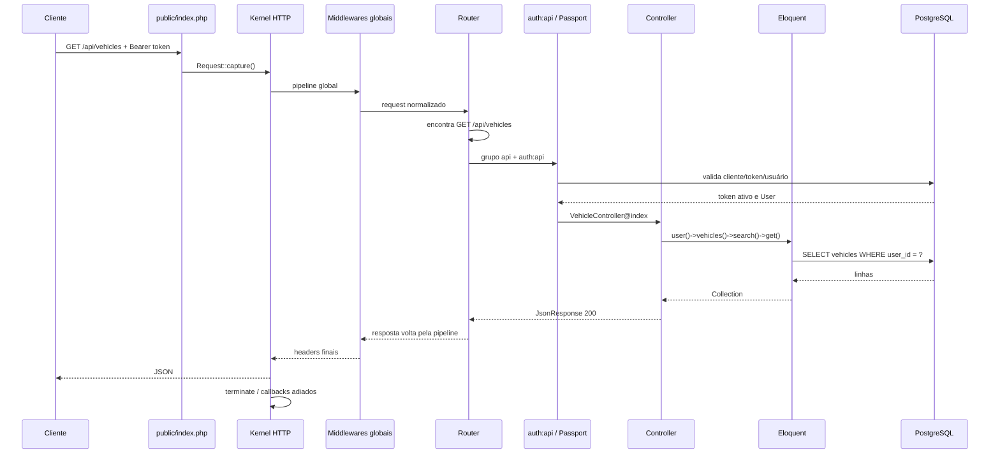

## O que existe e por quê

O projeto tem um entrypoint HTTP, `public/index.php`, e um entrypoint de console, `artisan`. Os dois carregam o autoload e o mesmo objeto criado por `bootstrap/app.php`: `public/index.php:13`, `public/index.php:18`, `artisan:9`, `artisan:14`.

No Laravel 13 deste projeto não existe `app/Http/Kernel.php`. Rotas, middlewares e exceptions são declarados pelo builder em `bootstrap/app.php:8`.

## Fluxo HTTP real

1. O servidor entrega a requisição a `public/index.php`; esse arquivo verifica manutenção pré-renderizada: `public/index.php:8`.
2. O Composer é carregado e `bootstrap/app.php` constrói a aplicação: `public/index.php:13`, `public/index.php:18`.
3. `Request::capture()` cria o request e `handleRequest()` resolve o Kernel: `public/index.php:20`, `vendor/laravel/framework/src/Illuminate/Foundation/Application.php:1223`.
4. O Kernel carrega ambiente, configuração, exceptions, facades e providers: `vendor/laravel/framework/src/Illuminate/Foundation/Http/Kernel.php:43`.
5. A pilha global recebe o request e o Router seleciona a rota: `vendor/laravel/framework/src/Illuminate/Foundation/Http/Kernel.php:164`, `vendor/laravel/framework/src/Illuminate/Routing/Router.php:762`.
6. O Router executa os middlewares da rota e chama a Closure ou controller: `vendor/laravel/framework/src/Illuminate/Routing/Router.php:811`.
7. O retorno é normalizado em resposta, volta pelas pipelines, é enviado e os middlewares termináveis executam: `vendor/laravel/framework/src/Illuminate/Foundation/Application.php:1227`, `vendor/laravel/framework/src/Illuminate/Foundation/Http/Kernel.php:211`.

## Diagrama de uma requisição autenticada

A rota está em `routes/api.php:52`; a consulta está em `app/Http/Controllers/VehicleController.php:15`; a relação que aplica `user_id` está em `app/Models/User.php:55`.

## Pilha global

A lista padrão é instalada porque a callback própria está vazia: `bootstrap/app.php:15`, `vendor/laravel/framework/src/Illuminate/Foundation/Configuration/Middleware.php:451`.

| Middleware | Função neste projeto |
|---|---|
| `ValidatePathEncoding` | Rejeita path que não seja UTF-8: `vendor/laravel/framework/src/Illuminate/Http/Middleware/ValidatePathEncoding.php:20`. |
| `InvokeDeferredCallbacks` | Executa callbacks adiados na terminação: `vendor/laravel/framework/src/Illuminate/Foundation/Http/Middleware/InvokeDeferredCallbacks.php:32`. |
| `TrustProxies` | Interpreta IP, host e HTTPS de proxies confiáveis: `vendor/laravel/framework/src/Illuminate/Http/Middleware/TrustProxies.php:52`. |
| `HandleCors` | Trata preflight e headers CORS: `vendor/laravel/framework/src/Illuminate/Http/Middleware/HandleCors.php:52`. |
| `PreventRequestsDuringMaintenance` | Interrompe com 503 em manutenção: `vendor/laravel/framework/src/Illuminate/Foundation/Http/Middleware/PreventRequestsDuringMaintenance.php:59`. |
| `ValidatePostSize` | Rejeita corpo maior que `post_max_size`: `vendor/laravel/framework/src/Illuminate/Http/Middleware/ValidatePostSize.php:19`. |
| `TrimStrings` | Apara strings, exceto senhas: `vendor/laravel/framework/src/Illuminate/Foundation/Http/Middleware/TrimStrings.php:16`, `vendor/laravel/framework/src/Illuminate/Foundation/Http/Middleware/TrimStrings.php:61`. |
| `ConvertEmptyStringsToNull` | Converte string vazia em `null`: `vendor/laravel/framework/src/Illuminate/Foundation/Http/Middleware/ConvertEmptyStringsToNull.php:41`. |

## Grupos e middlewares de rota

- `routes/api.php` recebe prefixo `/api` e grupo `api` automaticamente: `vendor/laravel/framework/src/Illuminate/Foundation/Configuration/ApplicationBuilder.php:211`.
- O grupo `api` contém somente `SubstituteBindings`: `vendor/laravel/framework/src/Illuminate/Foundation/Configuration/Middleware.php:495`.
- As rotas protegidas também recebem `auth:api`: `routes/api.php:29`.
- `routes/web.php` recebe o grupo `web`: `vendor/laravel/framework/src/Illuminate/Foundation/Configuration/ApplicationBuilder.php:253`.

O grupo `web` contém:

| Middleware | Efeito |
|---|---|
| `EncryptCookies` | Descriptografa cookies recebidos e criptografa cookies da resposta: `vendor/laravel/framework/src/Illuminate/Cookie/Middleware/EncryptCookies.php:72`. |
| `AddQueuedCookiesToResponse` | Anexa cookies enfileirados aos headers da resposta: `vendor/laravel/framework/src/Illuminate/Cookie/Middleware/AddQueuedCookiesToResponse.php:34`. |
| `StartSession` | Carrega e persiste sessão; o driver configurado é banco: `vendor/laravel/framework/src/Illuminate/Session/Middleware/StartSession.php:50`, `config/session.php:21`. |
| `ShareErrorsFromSession` | Expõe o error bag da sessão às views: `vendor/laravel/framework/src/Illuminate/View/Middleware/ShareErrorsFromSession.php:35`. |
| `PreventRequestForgery` | Valida origem/token CSRF em verbos de escrita: `vendor/laravel/framework/src/Illuminate/Foundation/Http/Middleware/PreventRequestForgery.php:95`. |
| `SubstituteBindings` | Resolve bindings explícitos/implícitos da rota: `vendor/laravel/framework/src/Illuminate/Routing/Middleware/SubstituteBindings.php:37`. |

A composição está em `vendor/laravel/framework/src/Illuminate/Foundation/Configuration/Middleware.php:484`. Neste projeto o grupo só atende `GET /`: `routes/web.php:5`.

O framework também registra os aliases `auth.basic`, `auth.session`, `cache.headers`, `can`, `guest`, `password.confirm`, `precognitive`, `signed`, `throttle` e `verified`, mas não encontrei uso deles nas rotas: `vendor/laravel/framework/src/Illuminate/Foundation/Configuration/Middleware.php:803`. Apenas `auth:api` é aplicado explicitamente.

## Exceptions

Exceções não tratadas são capturadas pelo Kernel: `vendor/laravel/framework/src/Illuminate/Foundation/Http/Kernel.php:141`. O projeto força JSON quando a URL começa com `api/` ou o cliente anuncia que espera JSON: `bootstrap/app.php:18`.

## Pontos de atenção

- Não há middleware customizado: `bootstrap/app.php:15`.
- Não há `throttle` no grupo API; login e cadastro estão expostos sem rate limiting: `routes/api.php:19`, `routes/api.php:21`.
- `SubstituteBindings` quase não atua porque as rotas usam IDs e os controllers chamam `find()` manualmente: `routes/api.php:56`, `app/Http/Controllers/VehicleController.php:29`.
- Não existe `config/cors.php`; vale a base permissiva do framework para `api/*`: `vendor/laravel/framework/config/cors.php:18`.
- Sessão usa banco na rota web, mas não existe migration local de `sessions`: `config/session.php:21`.

## Console

`artisan` carrega a mesma aplicação e chama `handleCommand()`: `artisan:14`, `artisan:16`. O único comando definido pela aplicação é `inspire`: `routes/console.php:6`.
