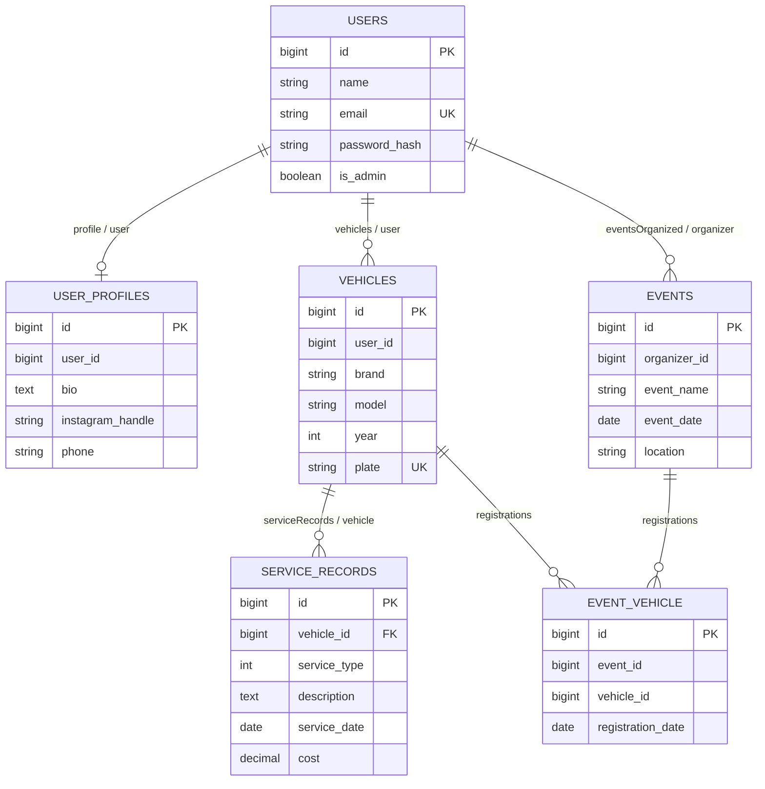

# 4. Models e relacionamentos

## Mapa geral

| Model | Tabela inferida | Fillable | Casts / hidden | Relações |
|---|---|---|---|---|
| `User` | `users` | `name`, `email`, `password_hash`: `app/Models/User.php:25` | Oculta `password_hash` e `remember_token`: `app/Models/User.php:31` | perfil, veículos, eventos organizados: `app/Models/User.php:43`, `app/Models/User.php:55`, `app/Models/User.php:67` |
| `UserProfile` | `user_profiles` | `user_id`, `bio`, `instagram_handle`, `phone`: `app/Models/UserProfile.php:19` | Nenhum cast/hidden | usuário: `app/Models/UserProfile.php:33` |
| `Vehicle` | `vehicles` | `user_id`, `brand`, `model`, `year`, `plate`: `app/Models/Vehicle.php:13` | Nenhum cast | usuário, serviços, eventos: `app/Models/Vehicle.php:34`, `app/Models/Vehicle.php:39`, `app/Models/Vehicle.php:44` |
| `ServiceRecord` | `service_records` | `vehicle_id`, `service_type`, `description`, `service_date`, `cost`: `app/Models/ServiceRecord.php:14` | enum, date e decimal: `app/Models/ServiceRecord.php:22` | veículo: `app/Models/ServiceRecord.php:36` |
| `Event` | `events` | `organizer_id`, `event_name`, `event_date`, `location`: `app/Models/Event.php:13` | `event_date` como date: `app/Models/Event.php:20` | organizador e veículos: `app/Models/Event.php:36`, `app/Models/Event.php:41` |

Todos usam a tabela e chave primária convencionais; nenhum model define `$table`, `$primaryKey` ou `$connection`.

Todos declaram `$fillable`; nenhum declara `$guarded` explicitamente. Em Eloquent, o `$fillable` de cada tabela acima é a lista que permite mass assignment.

## Diagrama ER lógico

O diagrama representa as relações declaradas pelos models. Algumas cardinalidades não estão garantidas por constraints no banco; isso é marcado abaixo.

## Scopes

`Vehicle::search()` procura `brand`, `model` e `plate`: `app/Models/Vehicle.php:21`. `Event::search()` procura nome e localização: `app/Models/Event.php:24`.

Ambos recebem o objeto HTTP `Request` diretamente e usam `ILIKE`. Isso acopla os models à camada HTTP e ao PostgreSQL: `app/Models/Vehicle.php:27`, `app/Models/Event.php:30`.

## Accessors, mutators e soft deletes

Não encontrei accessors, mutators ou uso de `SoftDeletes` em nenhum arquivo de `app/Models/`. Excluir chama `delete()` físico, por exemplo `app/Http/Controllers/VehicleController.php:59`.

## Serialização JSON

Os controllers devolvem os models diretamente. Assim, o JSON segue atributos, casts e `$hidden` dos models: `app/Http/Controllers/EventController.php:29`, `app/Http/Controllers/ServiceRecordController.php:51`.

- Datas castadas são serializadas segundo o Eloquent.
- `cost` sai como decimal com duas casas: `app/Models/ServiceRecord.php:25`.
- `service_type` sai como enum backed conforme a serialização do Eloquent: `app/Models/ServiceRecord.php:23`.
- Senha e remember token não saem no JSON de usuário: `app/Models/User.php:31`.

## Pontos de atenção

- O comentário de `ServiceRecord::vehicle()` diz “1 pra 1”, mas o inverso é `hasMany`; a relação real é N:1: `app/Models/ServiceRecord.php:29`, `app/Models/Vehicle.php:39`.
- `UserProfile.user_id` é fillable e não tem unique no banco; o 1:1 depende apenas do controller: `app/Models/UserProfile.php:19`, `database/migrations/2026_08_27_162054_create_user_profiles_table.php:17`.
- `organizer_id`, `user_id` e `vehicle_id` são mass assignable; chamadas futuras a `Model::create($request->all())` seriam perigosas.
- Relações não usam `withTimestamps()` na pivot e a pivot também não possui timestamps: `app/Models/Event.php:43`, `database/migrations/2026_08_27_172140_create_event_vehicle_table.php:22`.
- Não há eager loading. Acesso como `$serviceRecord->vehicle` dispara consulta adicional: `app/Http/Controllers/ServiceRecordController.php:47`.
